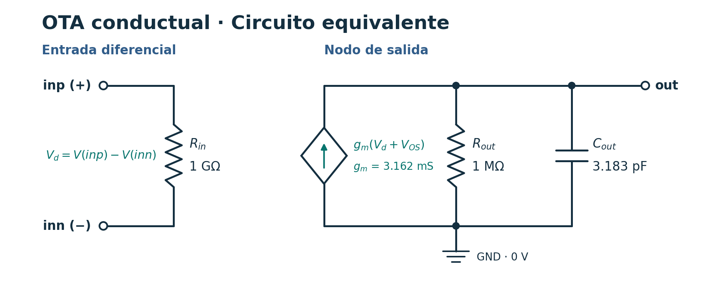
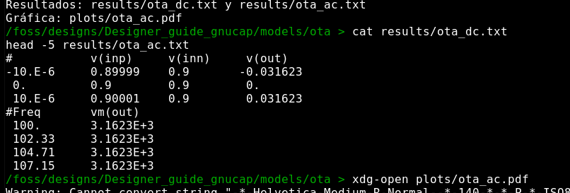
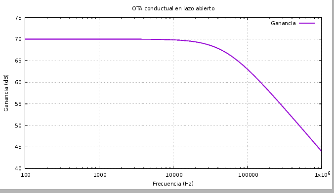
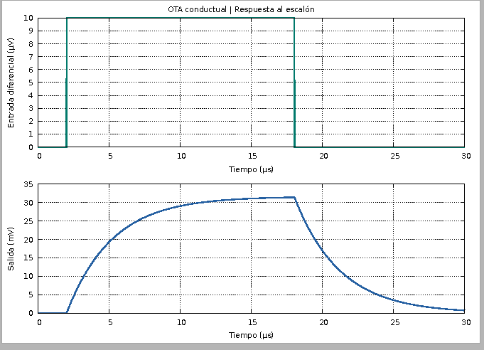

# OTA conductual en Verilog-A y Gnucap

Modelo equivalente de pequeña señal, con entrada diferencial y salida simple. Se planteó como un bloque conductual para el OTA de siete transistores, con parámetros ajustables para estudiar su uso en un front-end de EMG. Los valores de esta versión son objetivos del modelo.



## Compilar y simular

En el contenedor IIC-OSIC-Tools, con la instalación local de Gnucap y ModelGen:

```bash
source "$HOME/.local/gnucap/activate.sh"
cd /foss/designs/Designer_guide_gnucap
make ota
```

Si ya tienes Gnucap y ModelGen en el `PATH`, puedes ejecutar `make ota` directamente desde la raíz del repositorio. También necesitas `g++` y `make`. Gnuplot con soporte `pdfcairo` genera las gráficas. El ejemplo usa una fuente dependiente y elementos equivalentes, así que puede correr sin cargar un PDK.

`make ota` recompila el modelo cuando cambia el código, ejecuta el banco y guarda los datos en `models/ota/results/`. La curva AC y el transitorio quedan en `models/ota/plots/` cuando está disponible Gnuplot.

| Archivo | Función |
|---|---|
| `ota.vams` | Modelo conductual del amplificador. |
| `ota_tb.gc` | Banco de pruebas con barridos DC, AC y transitorio. |
| `build.sh` | Usa ModelGen para generar C++ y compila el complemento `ota.so`. |
| `run.sh` | Ejecuta el banco y genera los PDF si Gnuplot está disponible. |
| `ota.gp` y `ota_tran.gp` | Grafican la ganancia y la respuesta temporal. |

Para correr todos los ejemplos del repositorio, ejecuta `make build`, `make test </dev/null` y `make plot` en ese orden. Para abrir un PDF del OTA desde la raíz:

```bash
xdg-open models/ota/plots/ota_ac.pdf
xdg-open models/ota/plots/ota_tran.pdf
```

## Nodos y componentes

- **`inp` e `inn`** son las entradas positiva y negativa. `rin` se conecta entre ellas.
- **`out`** es el nodo común de la fuente dependiente, `rout` y el capacitor equivalente. Las tres ramas regresan a la referencia de **0 V**.
- **`vos`** es el offset referido a la entrada. Con `vos = 0` y entradas iguales, el modelo da 0 V en la salida.

| Parámetro | Valor nominal | Efecto |
|---|---:|---|
| `av` | 3162.28 V/V | Ganancia de baja frecuencia de 70 dB en lazo abierto, sin carga externa. |
| `rin` | 1 GΩ | Resistencia diferencial de entrada. |
| `rout` | 1 MΩ | Resistencia equivalente de salida. |
| `fp` | 50 kHz | Frecuencia del polo de salida sin carga externa. |
| `vos` | 0 V | Offset del caso nominal. |

La transconductancia y la capacitancia se calculan con los parámetros del modelo:

$$
g_m = \frac{A_v}{R_{out}} = 3.162\ \mathrm{mS},
\qquad
C_{out} = \frac{1}{2\pi R_{out} f_p} = 3.183\ \mathrm{pF}.
$$

En Verilog-A, las tres contribuciones de corriente se suman en `out`:

```verilog
I(out) <+ V(out) / rout;
I(out) <+ ddt(V(out)) / (6.283185307179586 * rout * fp);
I(out) <+ -(av / rout) * (V(inp, inn) + vos);
```

La primera línea representa la resistencia. La segunda aplica la relación de un capacitor, $i_C=C\,dv/dt$. La tercera inyecta corriente al nodo cuando la diferencia de entrada es positiva con offset cero. La capacitancia de esta versión se eligió para fijar el polo. Una extracción del layout permitiría estimar la capacitancia física y ajustar el equivalente.

## Resultados y capturas originales

### DC

El banco fija `inn` en 0.9 V y barre el voltaje diferencial. Cada fila muestra el estado estacionario para un punto del barrido.

| Barrido diferencial | `v(inp)` | `v(inn)` | `v(out)` |
|---:|---:|---:|---:|
| −10 µV | 0.89999 V | 0.90000 V | −31.623 mV |
| 0 µV | 0.90000 V | 0.90000 V | 0 V |
| +10 µV | 0.90001 V | 0.90000 V | +31.623 mV |



### AC

`#Freq` es la frecuencia de prueba en Hz. `vm(out)` es la magnitud AC de la salida. Con una excitación diferencial unitaria, el número corresponde a la ganancia en V/V. A 100 Hz se obtuvo **70.00 dB** y a 50.119 kHz se obtuvo **66.98 dB**, cerca del punto de −3 dB. A frecuencias suficientemente altas la pendiente se acerca a −20 dB por década.



[Captura original en el visor de PDF](figuras/ac-visor-original.png).

### Transitorio

El banco aplica un pulso diferencial de **0 a +10 µV** cerca de los **2 µs** y lo retira cerca de los **18 µs**. Mientras dura el pulso, la fuente dependiente carga el capacitor y la salida se acerca a **31.62 mV**. Cuando se retira, el capacitor se descarga por `rout`. La constante de tiempo es $R_{out} C_{out} \approx 3.18\ \mathrm{\mu s}$ y el tiempo de subida medido entre el 10 % y el 90 % del valor final es **6.99 µs**.



Las cifras corresponden al modelo lineal sin carga externa. Medir excursión de salida, ruido, consumo o modulación por chopper requiere extender el modelo o usar el circuito a transistores.

[Captura del repositorio de referencia](figuras/repositorio-original.png).
